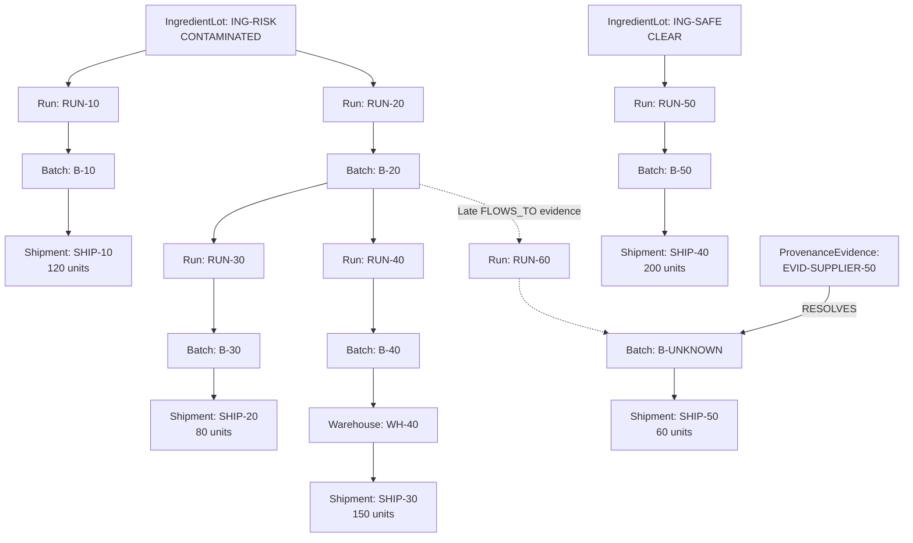

# LotGuard

### Graph-native supply-chain investigation and controlled recall operations

**Graph Hacks 2026 — FalkorDB × WeMakeDevs**  
**Submission track:** Track 01 — Agents That Act on Connected Data

LotGuard is a graph-powered incident-response prototype that traces contaminated ingredients through manufacturing runs, finished-product batches, and shipments. It identifies affected inventory, supports approval-controlled quarantine, and records intervention evidence inside FalkorDB.

**Core idea:** Quarantine what is actually connected to a contaminated lot while preserving unaffected inventory.

## Quickstart — Evolving Incident Demo

**Recommended demonstration for FalkorDB Graph Hacks 2026.**

LotGuard Sentinel is a graph-driven supply-chain incident response
prototype. It investigates contamination using FalkorDB, proposes
targeted quarantine, requires human approval, and records audit evidence.

### Run the application

With FalkorDB running locally, initialize the synthetic scenario:

```bash
uv run --no-sync python -m lotguard.deep_lineage
```

Start the operations dashboard:

```bash
uv run --no-sync python -m lotguard.sentinel_ui
```

Open http://127.0.0.1:8766 on the same computer.

### Two-wave demonstration

1. Investigate the initial contamination: 350 affected units across
   SHIP-10, SHIP-20 and SHIP-30.
2. Approve and verify the first quarantine.
3. Review SHIP-50's incomplete upstream provenance.
4. Click **Receive supplier evidence & reassess**.
5. Observe the new five-hop contamination path to SHIP-50.
6. Approve the additional 60-unit quarantine.
7. Verify two independent audit actions and 410 quarantined units.
8. Confirm that unrelated SHIP-40 remains in transit.

### Automated end-to-end verification

```bash
uv run --no-sync python tests/test_evolving_incidents.py
```

The test checks nine stages of the evolving incident lifecycle.

**Reset warning:** Both the test and the deep_lineage initialization
reset the synthetic lotguard_depth_demo graph and its audit history.

**Limitations:** This prototype uses deterministic graph-driven rules,
not LLM-driven autonomy. MCP tool selection is deterministic and evidence-conditioned. Supplier evidence is
synthetic. The dashboard runs locally and does not provide production
authentication or independent public-user sessions.

---

## Adaptive MCP Investigation Agent

LotGuard Sentinel includes a real Model Context Protocol (MCP)
integration backed by FalkorDB.

The investigator uses policy-driven tool selection to choose
operations based on live graph evidence and incident state.

### Available MCP tools

| Tool | Purpose |
|---|---|
| `inspect_incident` | Check whether an ingredient is contaminated |
| `trace_provenance` | Traverse connected shipments at 3 or 8 hops |
| `inspect_provenance_gaps` | Identify incomplete upstream lineage |
| `propose_response` | Generate a read-only containment proposal |
| `audit_history` | Inspect previous quarantine interventions |
| `execute_approved_quarantine` | Execute and verify human-approved quarantine |

### Run the MCP investigator

With FalkorDB running and the synthetic graph initialized:

```bash
uv run --no-sync python -m lotguard.tool_agent
```

Alternatively, start the Sentinel dashboard:

```bash
uv run --no-sync python -m lotguard.sentinel_ui
```

Open http://127.0.0.1:8766 and select
**Run MCP investigation and view tool trace**.

The trace page shows which MCP tools were invoked, why they
were selected, the connected shipments discovered, and the
resulting graph-grounded intervention proposal.

### MCP server

The standalone MCP server is implemented in
`src/lotguard/mcp_server.py` and supports stdio transport:

```bash
uv run --no-sync python -m lotguard.mcp_server
```

The dashboard uses an in-process MCP client connection;
a separate MCP server process is not required.

### Evidence-dependent tool selection

The verified agent follows different tool sequences:

1. **Initial contamination:** Trace affected shipments,
   propose containment, and inspect missing provenance.
2. **After first quarantine:** Also inspect recorded graph actions.
3. **After new supplier evidence:** Skip resolved provenance
   investigations and propose quarantine of only newly
   identified affected inventory.
4. **Unknown ingredient:** Stop after incident inspection,
   without proposing an intervention.

This is deterministic, evidence-conditioned MCP orchestration,
not an LLM-driven autonomous planning system.

### MCP verification

```bash
uv run --no-sync python tests/test_mcp_tools.py
uv run --no-sync python tests/test_mcp_agent_states.py
```

The state-transition test resets the synthetic deep-demo graph.

### Human-approved MCP action loop

The dashboard investigates through MCP, rechecks the current
FalkorDB evidence, and requires operator confirmation.

After approval, it issues a short-lived ticket scoped to the
exact shipments. The sixth MCP tool consumes that ticket,
executes quarantine, and verifies the FalkorDB audit record.

The complete action workflow is tested with:

`uv run --no-sync python tests/test_mcp_action.py`

**Safety:** The five MCP investigation tools are read-only.
The sixth MCP tool, `execute_approved_quarantine`, requires a
short-lived, single-use approval ticket scoped to the exact
shipments. The executor revalidates graph evidence and records
the verified intervention in FalkorDB.

Approval is provided through the local operator interface.
This is a demonstration safeguard, not production authentication
or authorization.

---

## Advanced FalkorDB Graph Model

This is the graph used in the recommended Sentinel demonstration
(`lotguard_depth_demo`).

### Connected supply-chain model



Solid arrows represent initial `FLOWS_TO` relationships.
Dashed arrows represent relationships added when the synthetic
supplier evidence arrives. The independent shipment SHIP-40 has
no known contamination path.

The operational graph also contains `QuarantineAction` nodes with
`TARGETS` relationships to affected shipments and `TRACED_FROM`
relationships to the contaminated ingredient. Each action stores
the supporting evidence and execution metadata.

### Essential FalkorDB traversal

The following Cypher pattern is used by the advanced investigator:

```cypher
MATCH p=(l:IngredientLot {id:$lot})
      -[:FLOWS_TO*1..8]->(s:Shipment)
RETURN s.id, s.status, s.units,
       length(p), [n IN nodes(p) | n.id]
ORDER BY s.id, length(p)
```

With `$lot = 'ING-RISK'`, this discovers connected shipments
through up to eight directed relationships.

A three-hop search initially identifies only SHIP-10.
The eight-hop search also finds SHIP-20 and SHIP-30.
After supplier evidence creates the additional lineage to
SHIP-50, the same investigation identifies its 60 units.

Sentinel derives its quarantine candidates from these results,
checks current shipment states, requests operator approval,
and writes verified intervention records back into FalkorDB.

See `src/lotguard/deep_lineage.py`,
`src/lotguard/deep_sentinel.py`,
`src/lotguard/late_evidence.py`, and
`src/lotguard/deep_executor.py` for the implementations.

---

## The problem

An ingredient may enter several manufacturing runs, be combined with other ingredients, and reach multiple downstream shipments. Identifying affected stock requires following the relationships between the original ingredient and downstream products.

Overly broad recalls waste safe inventory. Incomplete tracing leaves potentially unsafe products in circulation.

LotGuard uses a graph to support targeted, explainable intervention.

## Demonstrated functionality

- Multi-hop ingredient-to-shipment tracing in FalkorDB
- Identification of affected and unaffected inventory
- Evidence paths showing why each shipment is implicated
- State-aware investigation of pending and completed quarantines
- Human approval before synthetic quarantine actions
- Persistent graph-based intervention records
- A local interactive dashboard
- Deterministic verification of quarantine outcomes

LotGuard currently implements a deterministic, graph-driven investigation and action workflow. It includes evidence-conditioned MCP tool selection, but does not use an LLM or open-ended autonomous planning.

## Architecture

```text
Sentinel dashboard (localhost:8766; baseline: 8765)
              |
              v
Python HTTP server (standard library)
              |
              v
Investigation and quarantine logic
              |
              v
FalkorDB Python client
              |
              v
FalkorDB graph database (localhost:6379)
```

FalkorDB is the source of truth for ingredient lineage, shipment state, and quarantine action records. Removing the database would prevent the investigation and intervention workflows from functioning.

## Graph data model

### Node types

| Node | Purpose | Main properties |
|---|---|---|
| IngredientLot | Source ingredient lot | id, name, status |
| Run | Manufacturing event | id |
| Batch | Finished-product batch | id, units |
| Shipment | Outbound inventory movement | id, status |
| QuarantineAction | Recorded intervention | id, reason_lot |

### Relationships

```text
(IngredientLot)-[:USED_IN]->(Run)
(Run)-[:PRODUCED]->(Batch)
(Batch)-[:SENT_AS]->(Shipment)
(QuarantineAction)-[:TARGETS]->(Shipment)
```

A manufacturing run can consume multiple ingredient lots. Therefore, a finished batch may be connected to both safe and contaminated inputs.

A clear ingredient does not automatically imply that all downstream shipments are safe: another ingredient in the same manufacturing run might be contaminated.

## Essential Cypher query

The central contamination-tracing query is:

```cypher
MATCH (lot:IngredientLot {status:'CONTAMINATED'})
      -[:USED_IN]->(run:Run)
      -[:PRODUCED]->(batch:Batch)
      -[:SENT_AS]->(shipment:Shipment)
RETURN batch.id, shipment.id, batch.units
ORDER BY batch.id
```

This query traverses three relationship types to establish which shipments are downstream of contaminated ingredients.

The quarantine operation uses the same lineage relationships to select eligible shipments before changing their status and linking them to a `QuarantineAction` node.

Full query implementations are available in:

- `src/lotguard/seed.py`
- `src/lotguard/agent.py`
- `src/lotguard/quarantine.py`
- `src/lotguard/dashboard.py`

## Local setup

### Requirements

- Python 3.12+
- uv Python package manager
- Docker with Linux container support
- Local access to ports 6379 and 8765

### 1. Clone and install

```bash
git clone https://github.com/Grolds-Code/LotGuard.git
cd LotGuard
uv sync
```

### 2. Start FalkorDB

With a working Linux Docker CLI:

```bash
docker run -d --name lotguard-falkordb \
  -p 127.0.0.1:6379:6379 \
  -v lotguard-falkordb-data:/data \
  falkordb/falkordb:latest
```

If the container already exists but is stopped:

```bash
docker start lotguard-falkordb
```

On Windows with WSL, Docker Desktop's WSL integration should ordinarily make the Docker CLI available inside Ubuntu.

If that integration is unavailable but Docker Desktop's engine is running, the Windows CLI can also be invoked from WSL:

```bash
"/mnt/c/Program Files/Docker/Docker/resources/bin/docker.exe" version
```

Use that executable instead of `docker` for the container commands if necessary.

### 3. Seed the synthetic graph

```bash
uv run --no-sync python src/lotguard/seed.py
```

This creates the `lotguard_demo` graph with three ingredient lots, three manufacturing runs, three product batches, and three shipments.

**Warning:** Running the seed script again deletes and recreates only `lotguard_demo`, including its previous quarantine audit records. Use it to reset the synthetic demonstration.

### 4. Run the dashboard

```bash
uv run --no-sync python -m lotguard.dashboard
```

Open:

http://127.0.0.1:8765

### 5. Demonstrate an intervention

1. Select `ING-001`, the contaminated maize-flour lot.
2. Click **Investigate**.
3. Inspect the evidence paths to `SHIP-101` and `SHIP-102`.
4. Click **Approve quarantine** and accept the confirmation.
5. Verify that both affected shipments become `QUARANTINED`.
6. Verify that unaffected `SHIP-103` remains `IN_TRANSIT`.
7. Inspect the generated quarantine action under Audit History.

### 6. Run the command-line investigation

```bash
uv run --no-sync python -m lotguard.agent --lot ING-001
```

The investigator reports the paths and whether any pending interventions remain.

## Verified synthetic demonstration

| Shipment | Units | Post-action state |
|---|---:|---|
| SHIP-101 | 120 | QUARANTINED |
| SHIP-102 | 80 | QUARANTINED |
| SHIP-103 | 150 | IN_TRANSIT |

The demonstrated intervention quarantines 200 affected units while preserving 150 unaffected units.

A manual FalkorDB verification confirmed that the affected shipments were quarantined, the unaffected shipment was unchanged, and the quarantine action had relationships to both affected shipments.

These observations establish correctness for the small synthetic example, not general recall accuracy across real-world supply chains.

## Current limitations

- Synthetic dataset only
- The original baseline uses three hops; the advanced Sentinel traverses up to eight hops
- Deterministic decision rules, not LLM reasoning
- No real shipment-system or ERP integration
- Local-only demo without production authentication
- No formal optimization of replacement stock
- Not validated for operational food-safety decisions

This is a hackathon prototype, not a certified recall-management system.

## Technology

- Python 3.12
- FalkorDB graph database
- FalkorDB Python client
- Cypher
- Python standard-library HTTP server
- Docker
- uv

## Hackathon and AI-assistance disclosure

Created for Graph Hacks 2026, October 15–18.

ChatGPT assisted with architectural exploration, implementation drafts, debugging guidance, and documentation.

The participant configured the development environment, executed and reviewed the implementation, tested the FalkorDB queries and agent workflows, verified the intervention results, and managed the GitHub repository and submission.

The project includes reproducible tests, documented graph operations, and an explicit account of its current technical capabilities and limitations.

## Repository

https://github.com/Grolds-Code/LotGuard

## LotGuard Sentinel — Evidence-Based Intervention

Sentinel extends LotGuard with an evidence-producing investigation planner and an approval-controlled quarantine executor.

### Generate an investigation plan

~~~bash
uv run --no-sync python -m lotguard.sentinel --lot ING-001
~~~

The planner queries FalkorDB and produces:
- Ingredient-to-shipment evidence paths
- Pending quarantine recommendations
- Already-quarantined shipments
- Inventory with no known contamination path
- Escalation recommendations when appropriate
- A JSON evidence report in `reports/`

### Preview the intervention

~~~bash
uv run --no-sync python -m lotguard.executor --lot ING-001
~~~

This shows the proposed intervention without changing inventory.

### Execute an approved intervention

~~~bash
uv run --no-sync python -m lotguard.executor --lot ING-001 --approve
~~~

The executor quarantines targeted synthetic shipments, creates audit relationships in FalkorDB, and verifies the resulting inventory state.

Run `seed.py` beforehand to reset the demonstration.

### End-to-end evaluation

Start the local dashboard and execute:

~~~bash
uv run --no-sync python tests/test_e2e.py
~~~

The six tests verify initial inventory, approval enforcement, protection against recall actions for clear lots, targeted quarantine, graph audit records, and repeated-action behavior.

### Agent capabilities and limitations

Sentinel uses a deterministic, graph-driven tool workflow. It includes evidence-conditioned MCP tool selection, but does not use an LLM or open-ended autonomous reasoning.

Its evidence bundles provide auditable graph paths rather than formal proofs. All demonstrations use synthetic data.

## Deep-Provenance Investigation — Advanced Demonstration

LotGuard Sentinel includes a second synthetic scenario showing how the depth of a graph traversal affects contamination detection.

This advanced scenario runs in the separate `lotguard_depth_demo` graph and does not modify the original dashboard demonstration.

### 1. Initialize the deep-provenance graph

~~~bash
uv run --no-sync python -m lotguard.deep_lineage
~~~

This creates a multi-stage supply chain with ingredient transformations, reprocessing, warehousing, an independent shipment, and incomplete provenance.

The command resets `lotguard_depth_demo` each time it runs.

### 2. Run deep investigation

~~~bash
uv run --no-sync python -m lotguard.deep_sentinel
~~~

The planner discovers three affected shipments through paths of different lengths.

| Shipment | Path depth | Expected classification |
|---|---:|---|
| SHIP-10 | 3 hops | Affected |
| SHIP-20 | 5 hops | Affected |
| SHIP-30 | 6 hops | Affected |
| SHIP-40 | No known risk path | Not targeted |
| SHIP-50 | Incomplete provenance | Manual review |

### 3. Preview an intervention

~~~bash
uv run --no-sync python -m lotguard.deep_executor
~~~

The executor displays the evidence and requests approval without changing inventory.

### 4. Execute and verify

~~~bash
uv run --no-sync python -m lotguard.deep_executor --approve
~~~

The approved executor quarantines three affected shipments totaling 350 units, verifies the corresponding graph audit records, and confirms that unrelated shipment states remain unchanged.

SHIP-50 remains flagged for provenance investigation rather than being classified as safe.

### Why traversal depth matters

In this deliberately constructed five-shipment synthetic scenario:

- Traversal limited to three hops detects 1 of 3 known affected shipments.
- Traversal up to eight hops detects all 3 known affected shipments.
- Full paths are returned as evidence for each affected shipment.
- The resulting intervention is recorded and verified in FalkorDB.

This is a controlled demonstration of graph-traversal completeness, not an external benchmark or evidence of industrial recall accuracy.

### Implementation

- `src/lotguard/deep_lineage.py` — synthetic graph construction and traversal comparison
- `src/lotguard/deep_sentinel.py` — variable-depth investigation and planning
- `src/lotguard/deep_executor.py` — approval-controlled execution and graph verification

The advanced evolving-incident workflow is available through the Sentinel dashboard on port 8766. The original dashboard on port 8765 remains available as a baseline.

## Sentinel Operations Dashboard

The advanced Sentinel dashboard provides a unified interface for deep-provenance investigations, intervention approval, inventory inspection, and graph audit history.

### Launch the advanced demonstration

First, initialize the synthetic deep-provenance graph:

~~~bash
uv run --no-sync python -m lotguard.deep_lineage
~~~

This resets only `lotguard_depth_demo`.

Then start the advanced dashboard:

~~~bash
uv run --no-sync python -m lotguard.sentinel_ui
~~~

Open http://127.0.0.1:8766 in your browser.

### Interactive demonstration

The dashboard displays:

- Live inventory metrics from FalkorDB
- Evidence paths of 3, 5, and 6 hops
- A comparison of shallow and deep contamination tracing
- Pending quarantine decisions
- Explicit incomplete-provenance warnings
- Human-approved quarantine execution
- Current shipment states and recorded graph actions

Click **Approve and verify quarantine** to execute the proposed intervention in the synthetic database.

After confirmation, the dashboard refreshes to show the changed shipment states and audit records.

The dashboard uses Sentinel's existing deep investigation planner and executor; it does not implement a separate decision engine.

### Deployment and security

The dashboard is intended for local demonstration only and binds to the loopback interface. It does not implement production-grade authentication or authorization.

Do not expose the local server directly to the public internet without adding appropriate security controls.
